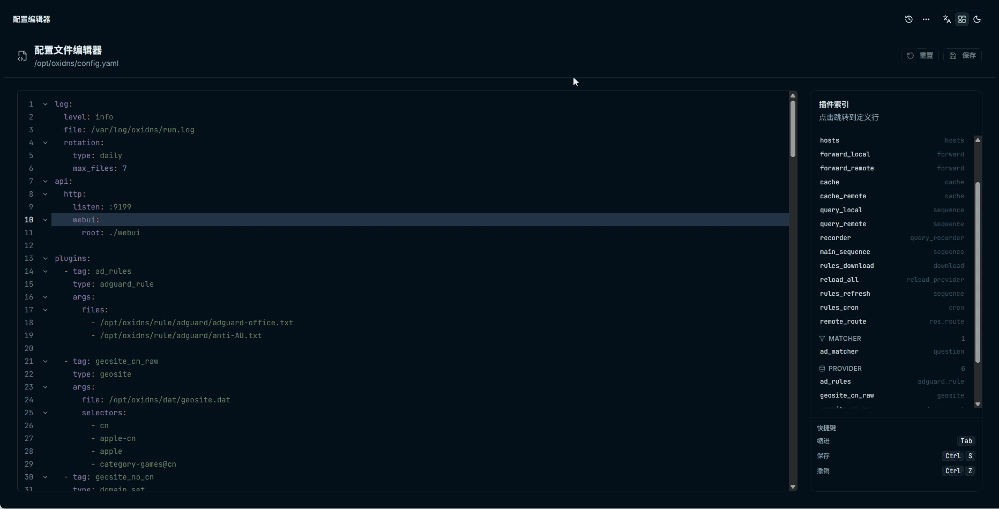
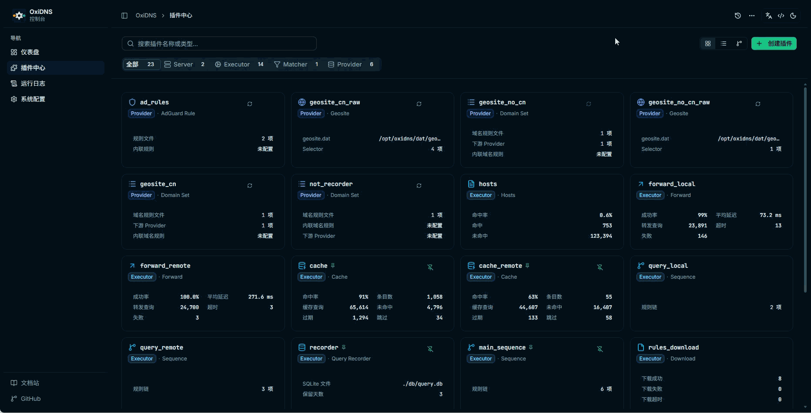
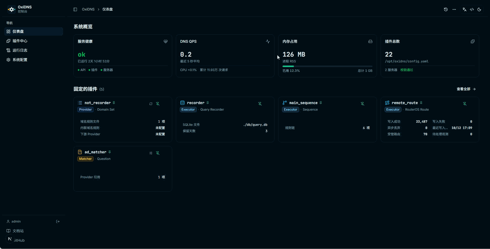

[](https://github.com/SvenShi/oxidns/releases)
[](https://github.com/svenshi/oxidns/releases/latest)
[](LICENSE)
[](https://github.com/svenshi/oxidns/actions/workflows/rust-ci.yml)
[](https://github.com/svenshi/oxidns/actions/workflows/webui-ci.yml)
[](https://github.com/svenshi/oxidns/actions/workflows/hotpath.yml)

[中文](README.md) | [English](README_EN.md) · [文档](https://oxidns.org/) · [快速开始](https://oxidns.org/quickstart) · [插件参考](https://oxidns.org/plugin-reference/overview)
## 本分支与上游的配置差异

以下比较本地 `main`（`53e5518c`）与上游 `origin/main`（`ad2046d3`，`svenshi/oxidns`），不包含构建依赖与 CI 配置。区分“仓库示例值”和“程序默认行为”：使用已有配置升级时，不会自动改写监听端口或上游地址。

### 默认配置文件 `config.yaml`

| 配置项 | 上游 | 本分支 | 作用与注意事项 |
| --- | --- | --- | --- |
| `runtime.provider_file_auto_reload` | 无此开关 | 显式为 `false` | 新增外部规则文件自动重载能力，但默认不启用，见下表。 |
| `api.http.listen` | `:9199` | `:9198` | 使用本分支根目录配置时，管理 API / WebUI 改用 9198；同步调整反向代理、防火墙及健康检查。 |
| `forward.args.upstreams[0].addr` | `223.5.5.5` | `udp://8.8.8.8` | 从阿里公共 DNS 改为 Google Public DNS；仍是明文 UDP，省略端口时使用 53。需确认部署网络可访问该上游。 |
| `udp_server.args.listen` / `tcp_server.args.listen` | `:5335` | `:53353` | DNS 的 UDP / TCP 入口都改为 53353；客户端、端口映射和转发规则须一起调整。 |


### 新增可选配置

下表中的插件字段均位于对应插件的 `args` 下；`upstreams[]` 是 `forward.args.upstreams[]`。

| 配置项 | 本分支默认值 | 作用 |
| --- | --- | --- |
| `runtime.provider_file_auto_reload` | `false` | 设为 `true` 后监听 `domain_set.files`、`ip_set.files`、`adguard_rule.files`、`geosite.file`、`geoip.file`；文件变化合并后只重载对应 provider，解析失败保留旧快照。不会监听 matcher 的直接 `&file` 或 `dynamic_domain_set.path`。 |
| `forward.on_error` | `fail` | `fail` 保持全部上游失败后向外返回错误；`continue` 则记录失败、继续后续 sequence，便于显式回退。后者不生成 DNS 响应、不清空已有响应，也不把上游返回的 `SERVFAIL` / `REFUSED` 当成连接错误。这样可以在主链最后新增一个fallback链兜底，如果没有has_wanted_ans,继续向fallback链设置的上游查询。|
| `forward.upstreams[].keepalive_interval` | 不启用 | 为 DoH2 发送空闲 HTTP/2 PING，为 DoH3 / DoQ 开启 QUIC keepalive，为 TCP / DoT 设置 TCP keepalive。支持如 `10s` 的时长，裸数字按秒；必须大于 0、短于非零 `idle_timeout`，QUIC 还须短于 `3 × timeout`，UDP 不支持。DoH2 的该值和 `idle_timeout` 必须小于 `2^32` 毫秒。 |
| `forward.upstreams[].use_post` | `false` | DoH / DoH3 默认仍用 GET；设为 `true` 改用 POST，将 DNS 报文放入请求体。两种方式都保留 URL 固定查询参数，非 DoH 协议忽略此项。 |
| `cache.lazy_refresh_concurrency` | `64` | 限制每个 cache 实例跨缓存键的后台 stale 刷新并发；同键仍去重，满额时继续返回 stale，不为刷新排队。 |
| `cache.lazy_refresh_timeout` | `10` 秒 | 单次后台刷新的超时；上游原先为内部固定 5 秒，本分支允许配置，默认避免抢先取消上游默认 5 秒超时。 |
| `cache.lazy_refresh_failure_cooldown` | `30` 秒 | 同一 stale 条目刷新失败后的重试冷却，减少上游故障期间的重复请求。上述三个刷新参数均须大于 0，且只有实际触发 lazy refresh 时才发挥作用。 |
| `udp_server.recv_buffer_size` | `1048576` 字节（1 MiB） | 新增可配置的内核 UDP 接收缓冲区，上游固定请求 64 KiB；有效范围 256 KiB–16 MiB，用于缓冲突发流量。实际大小受系统限制，设置失败会阻止该监听器启动。 |

### 示例：主上游失败或缺少所需记录时兜底

主转发设置 `on_error: continue`，使超时、连接失败等错误不会提前终止主链；随后通过 `!has_wanted_ans` 判断是否需要查询备用上游。下面的 `fallback_chain` 是普通 `sequence`，不是用于主备竞速的 `fallback` 插件。将片段中的插件合并到现有 `plugins` 列表，并让 DNS server 的 `entry` 指向 `main`；不要重复声明已有 tag。

```yaml
plugins:
  - tag: forward_primary
    type: forward
    args:
      on_error: continue
      upstreams:
        - addr: "udp://223.5.5.5:53"
          timeout: 2s

  - tag: forward_backup
    type: forward
    args:
      upstreams:
        - addr: "tls://1.1.1.1:853"
          timeout: 5s

  - tag: fallback_chain
    type: sequence
    args:
      - exec: "$forward_backup"

  - tag: main
    type: sequence
    args:
      - exec: "$forward_primary"
      - matches: "!has_wanted_ans"
        exec: "$fallback_chain"
      - exec: accept
```

- 主上游返回 Answer 中包含请求类型的记录：使用该响应，不查询备用上游。
- 主上游超时或连接失败：继续主链，由条件判断进入兜底链。
- 主上游返回 `SERVFAIL`、`REFUSED`、NXDOMAIN、NODATA，或仅 CNAME 而没有请求类型记录：也会进入兜底链。
- **若只希望完全没有响应时兜底**，把条件改为 `!has_resp`，避免对合法 NXDOMAIN / NODATA 再次查询。
- 备用转发未设置 `on_error`，保持默认 `fail`；备用上游也失败时会返回错误，不会无限重试。`has_wanted_ans` 只判断 Answer 是否含请求类型记录，不等同于完整的响应有效性或 CNAME 链校验。

### 旧字段的行为变化与迁移提醒

- **DoH / DoH3 429 自动退避**：不需要新增 YAML 参数；收到 HTTP 429 后按上游进入冷却，恢复时只放行单个探测请求，多上游转发会换用可用候选。`concurrent: 1` 在这种情况下可能顺序尝试其它候选，但同时在途仍最多一个。连接池与冷却配合减少重复建连/请求，并不保证公共 DNS 永不触发限速。
- **SOCKS5 出口范围扩大**：上游实现会忽略 UDP / DoQ / DoH3 的代理；本分支让这些协议也使用显式 `socks5` 或 `network.outbound` profile 的代理。代理必须支持 `UDP ASSOCIATE`；原来因忽略代理而直连的配置，现在可能走代理或因代理不支持而失败。
- **TCP / DoT 的 `idle_timeout` 真正控制空闲关闭**：从配置 TCP keepalive 改为按传输层读写活动判断并关闭空闲连接。两边源码的实际默认值都是 **30 秒**；上游注释/手册中的“10 秒”不代表默认值发生了变化。服务端空闲关闭与上表的上游连接保活是不同设置。
- **DoH URL 参数**：本分支保留固定 query 参数，但拒绝在 `addr` 中预设 `dns` 参数，避免与每次请求生成的 RFC 8484 参数冲突。
- **缓存 ECS 语义**：`cache.ecs_in_key` 默认仍为 `false`，但本分支明确剥离返回/存储响应中的 ECS，缓存键忽略 ECS，不同 ECS 客户端共享首次写入的结果；需要按 ECS scope 隔离/复用时设为 `true`。非法请求 ECS 旁路缓存，不代表整个查询被拒绝。
- **缓存 dump 格式不兼容**：本分支写入带版本头的 v4 格式，不接受该上游版本生成的无版本 dump。升级前备份 `dump_file` 并做好冷缓存启动准备；回滚时不要让新旧版本共用缓存文件。更改 `ecs_in_key` 也会影响恢复资格：开启时拒绝无 ECS 模式标记或来自关闭模式的 dump，关闭时丢弃 scoped 条目而不合并答案。
- **固定准入限制，不是新增 YAML 参数**：每个 server 实例最多 4096 个在途请求；TCP / DoT 每连接最多 128 个处理任务，HTTP/2 每连接最多 128 个并发流，QUIC 每连接最多 100 个双向流。UDP 饱和时丢包，流式协议施加背压；不能把这些内部值当作可配置字段。
- **查询记录与 nftset**：两者没有新增运行配置字段。查询记录属于尽力持久化，写入失败或退出超时可能丢记录；超过 4096 个轨迹事件的记录会被丢弃，响应快照有 16 MiB 上限。nftset 改为批量合并、规范化 CIDR 去重后写入，不需要迁移 YAML。
- **DoH 响应校验更严格**：成功响应必须提供有效的 `Content-Type: application/dns-message`，缺失或类型不符的非标准上游可能不再可用。
- **缓存持久化**：`dump_interval` 默认仍为 600 秒，本分支将其作为自动周期 dump 的最小间隔，低变更量可延后；手动与正常关闭 dump 不受此间隔限制。启动/重载恢复完成后才接收流量，且只有候选 runtime 完整启动成功后才开启自动保存，避免失败候选覆盖旧 dump。
- **配置校验加强但并非完整启动演练**：CLI `check`、管理 API 校验及默认的保存校验会调用插件专用校验钩子；当前新增实现在 `forward`，例如会拒绝 `on_error: ignore`。不能据此认定所有插件参数、文件、网络或监听资源均已通过运行验证。

使用本分支根目录的 `config.yaml` 时，可这样校验和探测（需已自行启动服务）：

```bash
oxidns check -c config.yaml
curl -fsS http://127.0.0.1:9198/api/health
dig @127.0.0.1 -p 53353 example.com
dig @127.0.0.1 -p 53353 example.com +tcp
```

以上新增参数没有全部写入默认模板；缓存后台刷新限制、保活与回退应按实际场景配置，不代表默认配置已开启缓存或代理。详细说明以仓库内的[全局配置](website/docs/configuration/global.md)、[转发与缓存参考](website/docs/plugin-reference/executor/resolution.mdx)、[UDP / TCP 参考](website/docs/plugin-reference/server/datagram-stream.mdx)和 [provider 参考](website/docs/plugin-reference/provider.mdx)为准；下文“快速开始”介绍的是上游 release 的安装流程与端口，不应套用于本分支根目录配置。上游在线文档与安装脚本下载的 release 不一定包含本分支扩展。

# OxiDNS

**面向复杂网络的高性能 DNS 策略编排引擎。**

OxiDNS 是一个使用 Rust 构建、面向软路由、OpenWrt、Homelab 和高级自建网络的插件化 DNS 引擎。它通过声明式策略组合匹配、缓存、转发、回退、改写、本地应答和系统联动，并提供 WebUI、管理 API、查询记录、Prometheus 指标和实时日志。

项目受 [mosdns](https://github.com/IrineSistiana/mosdns) 启发，但不止于规则分流：OxiDNS 将 DNS 请求、上游响应和网络副作用放进同一条可组合、可解释的策略管线，让复杂行为仍然能够被配置、验证和追踪。

[快速开始](https://oxidns.org/quickstart) · [配置总览](https://oxidns.org/configuration) · [常见场景](https://oxidns.org/scenarios) · [性能与基准](https://oxidns.org/benchmarks)

## 为什么选择 OxiDNS

- **策略可编排**：`sequence` 将 matcher、executor 和 provider 组合成可复用的条件分支、跳转和回退链，`load_balance` 支持执行链轮询、随机和加权随机。
- **决策可解释**：查询记录、执行路径、结构化日志和指标可以回答一次查询匹配了什么、执行了什么、为何选择当前结果。
- **接入与出口统一**：同一策略可服务 UDP、TCP、DoT、DoQ 和 DoH，并统一管理上游解析、连接复用、并发裁决与代理出口。
- **DNS 驱动网络行为**：解析结果可以直接联动 Linux `ipset` / `nftset`、RouterOS 地址列表与静态路由、HTTP webhook 和外部脚本。

OxiDNS 使用自有 DNS 消息模型与 wire 编解码层，并把规则编译、依赖分析和连接初始化尽可能移出请求热路径；设计方法和历史测试结果见[性能与基准](https://oxidns.org/benchmarks)。

核心请求路径保持清晰：

```text
client -> server -> sequence (matcher + executor + provider)
                         |-> upstream / local answer -> response
                         `-> side effects
```

## 策略配置是什么样的

下面的配置把 `corp.lan` 交给内网 DNS，其余域名使用加密上游。Provider、matcher、executor 和 server 通过 tag 组合，不需要把策略写进协议入口：

```yaml
plugins:
  - tag: internal_domains
    type: domain_set
    args:
      exps: ["domain:corp.lan"]

  - tag: forward_internal
    type: forward
    args:
      upstreams:
        - addr: "udp://192.168.1.1:53"

  - tag: forward_public
    type: forward
    args:
      upstreams:
        - addr: "tls://dns.quad9.net:853"
          bootstrap: "9.9.9.9:53"

  - tag: main
    type: sequence
    args:
      - matches: "qname $internal_domains"
        exec: "$forward_internal"
      - matches: "!has_resp"
        exec: "$forward_public"
      - exec: accept

  - tag: dns_server
    type: udp_server
    args:
      entry: main
      listen: ":5335"
```

完整配置结构、复用规则和更多部署模板见[配置总览](https://oxidns.org/configuration)与[常见场景](https://oxidns.org/scenarios)。

---

## 核心能力

| 类别 | 能力 |
| --- | --- |
| 协议接入 | UDP、TCP、DoT、DoQ、DoH（HTTP/1.1、HTTP/2、HTTP/3） |
| 策略编排 | `sequence`、条件匹配、执行器组合、跳转、回退链与 `load_balance` |
| 上游与出口 | 多协议上游、并发响应裁决、连接复用、bootstrap、SOCKS5、统一 `network.outbound` |
| 响应处理 | TTL 感知缓存与负缓存、ECS 与 ECS 客户端地址映射、本地记录、重定向、响应构造、双栈与 IP 优选 |
| 规则数据 | 域名与 IP 集、GeoIP、GeoSite、AdGuard 规则、动态域名学习 |
| 系统联动 | Linux `ipset` / `nftset`、RouterOS address-list / static route、HTTP webhook、外部脚本 |
| 可观测性 | 查询审计与执行路径、实时日志、Prometheus 指标、上游探测、健康检查 |
| 运行时管理 | 配置校验与热重载、matcher 基础结果固定、provider 定向重载、缓存与升级管理 |
| 部署能力 | 多平台构建、Debian 包、OpenWrt LuCI 插件、内置 WebUI 与管理 API、服务化安装 |

完整的内置组件和配置字段见[插件参考](https://oxidns.org/plugin-reference/overview)。

---

## WebUI 演示

### 配置编辑

直接编辑 YAML 配置，通过插件索引快速定位插件定义。



### 插件依赖图

以依赖图查看插件引用、`sequence` 分支和执行器组合。



### 查询追踪

从查询记录查看响应详情、匹配结果和实际执行路径。



---

## 社区 WebUI

除了内置 WebUI，也推荐体验社区开发者独立维护的管理界面：

- [YoPilot](https://github.com/yyhoworks/YoPilot)：由 yyhoworks 开发的中文管理前端，提供解析拓扑、插件配置和双皮肤界面。
- [OxiDNS Dashboard](https://github.com/Luke-Lab666/oxidns-dashboard)：由 Luke-Lab666 开发的轻量管理面板，构建为单个 HTML 文件，支持多种主题、查询日志和配置管理。

感谢社区开发者的贡献！部署方法和适配版本请参阅各项目说明。

---

## 快速开始

一条命令安装最新 release，并默认注册和启动为系统服务：

```bash
curl -fsSL https://oxidns.org/install.sh | sudo sh
```

Windows 管理员 PowerShell：

```powershell
irm https://oxidns.org/install.ps1 | iex
```

默认情况下，安装脚本会下载对应平台的 release、安装 WebUI，并注册和启动系统服务。

安装完成后，可以验证管理端和默认 DNS 服务：

```bash
curl -fsS http://127.0.0.1:9199/api/health
dig @127.0.0.1 example.com
dig @127.0.0.1 example.com +tcp
```

WebUI 默认地址为 `http://服务器IP:9199/`。允许其他设备访问前，请启用 `api.http.auth` 并通过防火墙或反向代理限制来源。修改配置后，请先使用 `oxidns check` 校验。

OpenWrt 会通过同一个安装脚本安装 [`luci-app-oxidns`](https://github.com/svenshi/luci-app-oxidns)。完成首次查询见[快速开始](https://oxidns.org/quickstart)；手动下载、Docker、Debian 包、便携安装和卸载见文档中的“安装与部署”；按需裁剪协议和插件见[自定义编译](https://oxidns.org/custom-build)。

## 适合谁

OxiDNS 适合需要长期运行、精细控制和完整可观测性的 DNS 环境，例如：

- 家庭网关、旁路由、OpenWrt、NAS 和 Homelab
- 按域名、客户端、查询类型或响应结果进行策略路由
- 多上游并发、主备回退、加密 DNS 与自定义出口
- 广告过滤、本地覆盖、双栈偏好、ECS 和动态规则学习
- 由 DNS 结果驱动防火墙集合、地址列表或策略路由

它不是权威 DNS 服务，也不是无需理解配置模型的一键广告过滤面板。如果你的首要需求是开箱即用的图形化管理，其他面向该场景的产品可能更合适；OxiDNS 更适合愿意用一定配置复杂度换取控制力和可解释性的用户。

---

## 文档

- **开始使用**：[快速开始](https://oxidns.org/quickstart) · [配置总览](https://oxidns.org/configuration) · [常见场景](https://oxidns.org/scenarios) · [从 mosdns 迁移](https://oxidns.org/migrate-from-mosdns)
- **参考手册**：[插件总览](https://oxidns.org/plugin-reference/overview) · [管理 API](https://oxidns.org/api) · [命令行工具](https://oxidns.org/cli) · [DNS 编码速查](https://oxidns.org/dns-codes)
- **部署运维**：[运维与故障排查](https://oxidns.org/operations) · [安全加固](https://oxidns.org/security) · [WebUI](https://oxidns.org/webui) · [OpenWrt](https://oxidns.org/openwrt)
- **了解项目**：[架构与设计](https://oxidns.org/architecture-and-design) · [性能与基准](https://oxidns.org/benchmarks) · [文档版本](https://oxidns.org/documentation) · [版本更新](https://oxidns.org/releases) · [路线图](https://oxidns.org/roadmap)
- **参与社区**：[贡献指南](https://oxidns.org/contributing) · [支持项目开发](https://oxidns.org/support-development) · [GitHub Discussions](https://github.com/svenshi/oxidns/discussions) · [Telegram](https://t.me/oxidns)

## 项目状态

OxiDNS 仍在持续开发，适合高级家庭网络、软路由、Homelab 和其他可控的自建网络环境。用于生产或关键网络前，请完成配置与回退验证、容量评估和监控建设。DNS 配置会直接影响网络可用性，请在变更前保留可恢复的配置和旁路方案。

欢迎提交 Issue、反馈真实场景、改进文档或贡献插件。

---

## 维护者

OxiDNS 主要由 [Sven Shi](https://github.com/svenshi) 创建和维护。

项目基于 Rust 开发，涉及 **DNS、异步网络编程、系统架构与基础设施工程**，持续关注性能优化、工程质量及实际应用场景。

欢迎交流相关技术问题、分享使用经验或探讨技术合作。如果你对这些领域感兴趣，欢迎通过 [Email](mailto:isvenshi@gmail.com) 与我联系。

---

## 社区交流

欢迎加入 Telegram 群与作者和其他用户交流：[**@OXIDNS** · https://t.me/oxidns](https://t.me/oxidns)

<a href="https://t.me/oxidns">
  
</a>

---

## 支持项目开发

如果 OxiDNS 对你有帮助，可以通过微信或支付宝支持项目的持续开发与维护。支持完全自愿，感谢每一份认可。

<table>
  <tr>
    <th align="center">微信支付</th>
    <th align="center">支付宝</th>
  </tr>
  <tr>
    <td align="center"></td>
    <td align="center"></td>
  </tr>
</table>

资金支持不会建立商业服务关系，也不会影响功能规划或问题处理的优先级。其他支持方式请参阅[贡献指南](https://oxidns.org/contributing)。

---

## 许可证

本项目基于 [GNU General Public License v3.0 or later](LICENSE) 开源。

独立的自有库 [oxidns-proto](crates/proto/README.md) 和
[oxidns-macros](crates/macros/README.md) 采用 `MIT OR Apache-2.0` 双重许可证，
使用者可以任选其一。其他 workspace crate 的许可证见各自的 `Cargo.toml`
和许可证文件。
