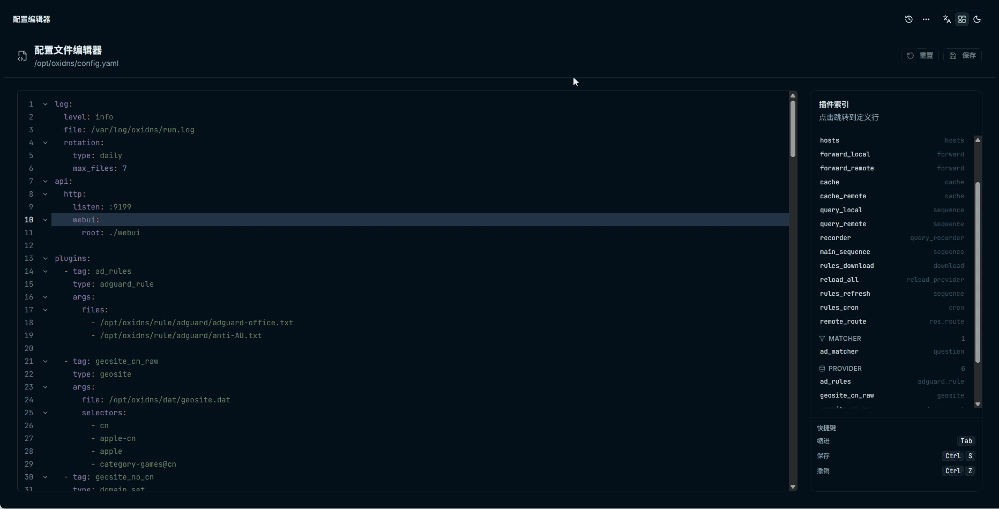
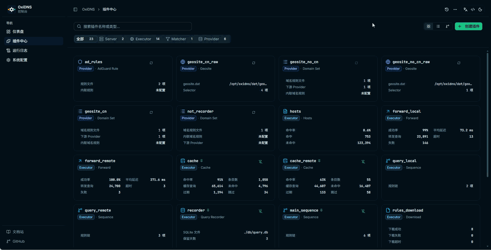
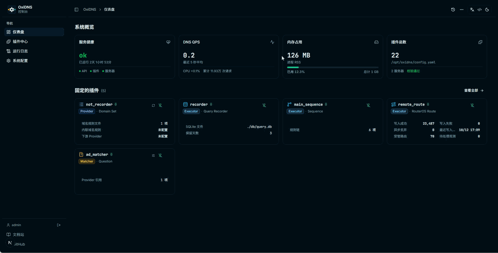

[](https://github.com/SvenShi/oxidns/releases)
[](https://github.com/svenshi/oxidns/releases/latest)
[](LICENSE)
[](https://github.com/svenshi/oxidns/actions/workflows/rust-ci.yml)
[](https://github.com/svenshi/oxidns/actions/workflows/webui-ci.yml)

[中文](README.md) | [English](README_EN.md) · [Documentation](https://oxidns.org/en/) · [Quick Start](https://oxidns.org/en/quickstart) · [Plugin Reference](https://oxidns.org/en/plugin-reference/overview)

## Configuration differences from upstream

This compares local `main` (`53e5518c`) with `origin/main` (`ad2046d3`, `svenshi/oxidns`), excluding build dependencies and CI configuration. Repository example values are not implicit application defaults: upgrading with an existing configuration does not rewrite its ports or upstream addresses.

### Root `config.yaml`

| Setting | Upstream | This branch | Purpose and operational impact |
| --- | --- | --- | --- |
| `runtime.provider_file_auto_reload` | Not available | Explicitly `false` | Adds opt-in rule-file watching, disabled by default; see below. |
| `api.http.listen` | `:9199` | `:9198` | Moves the management API / WebUI to 9198 when using this file; update reverse proxies, firewall rules, and health checks. |
| `forward.args.upstreams[0].addr` | `223.5.5.5` | `udp://8.8.8.8` | Switches from AliDNS to Google Public DNS. This remains unencrypted UDP on implicit port 53; verify reachability from the deployment network. |
| `udp_server.args.listen` / `tcp_server.args.listen` | `:5335` | `:53353` | Moves both DNS listeners to 53353; update clients, port mappings, and forwarding rules together. |

The branch also adds the commented example `#socks5: 127.0.0.1:1085`; **a comment does not enable a proxy**. The other configuration template, [`config.minimal.yaml`](config.minimal.yaml), is unchanged from this upstream revision.

### New optional settings

Plugin fields below belong under that plugin's `args`; `upstreams[]` means `forward.args.upstreams[]`.

| Setting | Branch default | Purpose |
| --- | --- | --- |
| `runtime.provider_file_auto_reload` | `false` | When enabled, watches `domain_set.files`, `ip_set.files`, `adguard_rule.files`, `geosite.file`, and `geoip.file`. Coalesced file events reload only the affected provider; invalid updates retain the old snapshot. Direct matcher `&file` rules and `dynamic_domain_set.path` are excluded. |
| `forward.on_error` | `fail` | `fail` propagates failure when all upstream attempts fail. `continue` records the failure and continues the sequence for explicit fallback; it creates no response, preserves any existing response, and does not treat DNS messages such as `SERVFAIL` / `REFUSED` as connection errors. |
| `forward.upstreams[].keepalive_interval` | Disabled | Enables idle HTTP/2 PING for DoH2, QUIC keepalive for DoH3 / DoQ, or TCP keepalive for TCP / DoT. Accepts durations such as `10s`, with bare numbers in seconds. Must be positive and below a nonzero `idle_timeout`; QUIC also requires it below `3 × timeout`. Unsupported for UDP. DoH2 requires this value and `idle_timeout` below `2^32` milliseconds. |
| `forward.upstreams[].use_post` | `false` | DoH / DoH3 still use GET by default; `true` sends the DNS message in a POST body. Both methods preserve fixed URL query parameters. Ignored for non-DoH protocols. |
| `cache.lazy_refresh_concurrency` | `64` | Caps concurrent stale refreshes across keys per cache instance. Same-key refreshes remain deduplicated; saturation serves stale without queuing refresh work. |
| `cache.lazy_refresh_timeout` | `10` seconds | Makes the formerly fixed 5-second background refresh timeout configurable; the new default avoids preempting the upstream's default 5-second deadline. |
| `cache.lazy_refresh_failure_cooldown` | `30` seconds | Delays retries for a stale entry after a failed refresh, reducing repeated traffic during outages. All three refresh settings must be positive and only matter when lazy refresh actually runs. |
| `udp_server.recv_buffer_size` | `1048576` bytes (1 MiB) | Makes the requested kernel UDP receive buffer configurable, replacing upstream's fixed 64 KiB request. Valid range: 256 KiB–16 MiB. Helps absorb bursts; OS limits still apply, and failure to set the buffer prevents listener startup. |

### Changed semantics and migration notes

- **Automatic DoH / DoH3 HTTP 429 backoff**: no new YAML setting is required. A rate-limited upstream enters cooldown and admits only one recovery probe; multi-upstream forwarding can use available alternatives. Even `concurrent: 1` can try another candidate sequentially during this recovery, while keeping at most one query in flight. Pooling and cooldown reduce repeated connections/requests, but cannot guarantee that public resolvers never rate-limit traffic.
- **SOCKS5 now covers more transports**: upstream ignores proxies for UDP / DoQ / DoH3; this branch applies explicit `socks5` and `network.outbound` profile proxies to those protocols too. The proxy must support `UDP ASSOCIATE`. Configurations that previously connected directly because the proxy was ignored may now use it or fail if unsupported.
- **TCP / DoT `idle_timeout` now closes inactive connections**: it measures transport read/write inactivity instead of configuring TCP keepalive. The actual source default is **30 seconds in both revisions**; upstream's “10 seconds” comment/manual is stale, not a changed default. Listener idle closure and upstream connection keepalive are separate settings.
- **DoH URL parameters**: fixed query parameters are preserved, but a preconfigured `dns` parameter in `addr` is rejected to avoid conflicting with generated RFC 8484 parameters.
- **Cache ECS behavior**: `cache.ecs_in_key` still defaults to `false`; this branch strips ECS from returned/stored responses and ignores ECS in the key, sharing the first cached result across ECS clients. Set `true` for scope-aware ECS isolation/reuse. Invalid request ECS bypasses caching, rather than rejecting the entire query.
- **Incompatible cache dump format**: this branch writes versioned v4 dumps and rejects the unversioned dumps generated by the compared upstream revision. Back up `dump_file` before upgrading and prepare for a cold cache; do not share a cache file between old and new versions during rollback. Changing `ecs_in_key` also affects restore eligibility: enabling it rejects dumps without ECS-mode metadata or from disabled mode; disabling it discards scoped entries instead of merging their answers.
- **Fixed admission limits, not new YAML settings**: each server instance admits at most 4096 in-flight requests; TCP / DoT allows 128 handlers per connection, HTTP/2 allows 128 concurrent streams per connection, and QUIC allows 100 bidirectional streams per connection. Saturated UDP drops packets; stream transports apply backpressure. These internal values are not configurable fields.
- **Query recorder and nftset**: neither adds runtime configuration fields. Recording is best-effort: write failures or shutdown timeouts can lose records; records exceeding 4096 trace events are dropped, and response snapshots have a 16 MiB limit. nftset now coalesces batches and deduplicates canonical CIDRs before writing, requiring no YAML migration.
- **Stricter DoH response validation**: successful responses must provide a valid `Content-Type: application/dns-message`; nonstandard upstreams omitting it or returning another media type may stop working.
- **Cache persistence**: `dump_interval` still defaults to 600 seconds and is a minimum interval for automatic periodic dumps; low churn may delay them. Manual and normal shutdown dumps are exempt. Restore finishes before serving traffic, and automatic saving is enabled only after the candidate runtime fully starts, preventing failed startup/reload candidates from overwriting an existing dump.
- **Stronger validation, not a startup rehearsal**: CLI `check`, API validation, and default save validation invoke plugin-specific hooks. The newly implemented hook is for `forward`, rejecting values such as `on_error: ignore`. This does not prove that every plugin argument, file, network dependency, or listener resource is operational.

To validate and probe this branch's root `config.yaml` (start the service separately):

```bash
oxidns check -c config.yaml
curl -fsS http://127.0.0.1:9198/api/health
dig @127.0.0.1 -p 53353 example.com
dig @127.0.0.1 -p 53353 example.com +tcp
```

Not all new settings are present in the default template; refresh limits, keepalive, and fallback should be configured for the deployment. The default file does not enable caching or proxying. See the repository's [global configuration](website/i18n/en/docusaurus-plugin-content-docs/current/configuration/global.md), [forward/cache reference](website/i18n/en/docusaurus-plugin-content-docs/current/plugin-reference/executor/resolution.mdx), [UDP/TCP reference](website/i18n/en/docusaurus-plugin-content-docs/current/plugin-reference/server/datagram-stream.mdx), and [provider reference](website/i18n/en/docusaurus-plugin-content-docs/current/plugin-reference/provider.mdx). The Quick Start below describes upstream release installation and ports, not this branch's root configuration. Upstream online documentation and installer-downloaded releases may not include these branch extensions.

# OxiDNS

**A high-performance DNS policy orchestration engine for complex networks.**

OxiDNS is a plugin-driven DNS engine built with Rust for software routers, OpenWrt, homelabs, and advanced self-hosted networks. Declarative policies compose matching, caching, forwarding, fallback, rewriting, local answers, and system integrations, while the WebUI, management API, query records, Prometheus metrics, and real-time logs provide the control plane.

Inspired by [mosdns](https://github.com/IrineSistiana/mosdns), OxiDNS goes beyond rule-based forwarding: requests, upstream responses, and network side effects share one composable and explainable policy pipeline, so complex behavior can still be configured, validated, and traced.

[Quick Start](https://oxidns.org/en/quickstart) · [Configuration](https://oxidns.org/en/configuration) · [Common Scenarios](https://oxidns.org/en/scenarios) · [Performance and Benchmarks](https://oxidns.org/en/benchmarks)

## Why OxiDNS

- **Composable policy**: `sequence` combines matchers, executors, and providers into reusable branches, jumps, and fallback chains; `load_balance` adds round-robin, random, and weighted-random branch selection.
- **Explainable decisions**: Query records, execution paths, structured logs, and metrics show what matched, what ran, and why a result was selected.
- **Unified ingress and egress**: One policy serves UDP, TCP, DoT, DoQ, and DoH while upstream resolution, connection reuse, concurrent selection, and proxy egress stay centrally managed.
- **DNS-driven networking**: Resolution results can update Linux `ipset` / `nftset`, RouterOS address lists and static routes, HTTP webhooks, and external scripts.

OxiDNS has its own DNS message and wire codec, and moves rule compilation, dependency analysis, and connection initialization out of the request hot path whenever possible. See [Performance and Benchmarks](https://oxidns.org/en/benchmarks) for the methodology and historical results.

The request path stays explicit:

```text
client -> server -> sequence (matcher + executor + provider)
                         |-> upstream / local answer -> response
                         `-> side effects
```

## What a policy looks like

This configuration sends `corp.lan` to an internal resolver and everything else to an encrypted upstream. Providers, matchers, executors, and servers compose through tags instead of embedding policy in protocol listeners:

```yaml
plugins:
  - tag: internal_domains
    type: domain_set
    args:
      exps: ["domain:corp.lan"]

  - tag: forward_internal
    type: forward
    args:
      upstreams:
        - addr: "udp://192.168.1.1:53"

  - tag: forward_public
    type: forward
    args:
      upstreams:
        - addr: "tls://dns.quad9.net:853"
          bootstrap: "9.9.9.9:53"

  - tag: main
    type: sequence
    args:
      - matches: "qname $internal_domains"
        exec: "$forward_internal"
      - matches: "!has_resp"
        exec: "$forward_public"
      - exec: accept

  - tag: dns_server
    type: udp_server
    args:
      entry: main
      listen: ":5335"
```

See [Configuration](https://oxidns.org/en/configuration) and [Common Scenarios](https://oxidns.org/en/scenarios) for the complete structure, reusable rules, and deployment patterns.

---

## Core Capabilities

| Category | Capabilities |
| --- | --- |
| Protocol ingress | UDP, TCP, DoT, DoQ, DoH over HTTP/1.1, HTTP/2, and HTTP/3 |
| Policy orchestration | `sequence`, conditional matching, executor composition, jumps, fallback chains, and `load_balance` |
| Upstreams and egress | Multi-protocol upstreams, concurrent response selection, connection reuse, bootstrap, SOCKS5, unified `network.outbound` |
| Response processing | TTL-aware positive and negative caching, ECS and ECS-derived client IPs, local records, redirects, response construction, dual-stack and IP selection |
| Rule data | Domain and IP sets, GeoIP, GeoSite, AdGuard rules, dynamic domain learning |
| System integrations | Linux `ipset` / `nftset`, RouterOS address lists / static routes, HTTP webhooks, external scripts |
| Observability | Query auditing and execution paths, real-time logs, Prometheus metrics, upstream probes, health checks |
| Runtime management | Config validation and hot reload, fixed matcher base results, targeted provider reloads, cache and upgrade management |
| Deployment | Multi-platform builds, Debian packages, OpenWrt LuCI app, built-in WebUI and management API, service installation |

See the [Plugin Reference](https://oxidns.org/en/plugin-reference/overview) for the complete list of built-in components and configuration fields.

---

## WebUI Demos

### Configuration Editor

Edit YAML configuration directly and use the plugin index to jump to plugin definitions.



### Plugin Dependency Graph

Explore plugin references, `sequence` branches, and executor composition in a dependency graph.



### Query Tracing

Inspect response details, match results, and the actual execution path from query records.



---

## Community WebUIs

Alongside the built-in WebUI, we recommend exploring these independently maintained community interfaces:

- [YoPilot](https://github.com/yyhoworks/YoPilot): A Chinese-language management frontend by yyhoworks, featuring DNS topology visualization, plugin configuration, and two visual styles.
- [OxiDNS Dashboard](https://github.com/Luke-Lab666/oxidns-dashboard): A lightweight management panel by Luke-Lab666, built as a single HTML file with multiple themes, query logs, and configuration management.

Thanks to the community developers for their contributions! See each project for deployment instructions and supported OxiDNS versions.

---

## Quick Start

Install the latest release with one command. By default this installs and starts OxiDNS as a system service:

```bash
curl -fsSL https://oxidns.org/install.sh | sudo sh
```

Elevated Windows PowerShell:

```powershell
irm https://oxidns.org/install.ps1 | iex
```

By default, the installer downloads the matching release, installs the WebUI, and registers and starts the system service.

After installation, verify the management endpoint and the default DNS service:

```bash
curl -fsS http://127.0.0.1:9199/api/health
dig @127.0.0.1 example.com
dig @127.0.0.1 example.com +tcp
```

The WebUI is available at `http://SERVER_IP:9199/` by default. Before allowing access from other devices, enable `api.http.auth` and restrict sources with a firewall or reverse proxy. Run `oxidns check` after changing configuration.

On OpenWrt, the same installer installs [`luci-app-oxidns`](https://github.com/svenshi/luci-app-oxidns). Use the [Quick Start](https://oxidns.org/en/quickstart) for the first successful query; see “Installation & Deployment” in the manual for archives, Docker, Debian packages, portable installs, and uninstallation; see [Custom Build](https://oxidns.org/en/custom-build) to strip optional protocols and plugins.

## Who it is for

OxiDNS fits long-running DNS environments that need fine-grained control and complete observability, including:

- Home gateways, software routers, OpenWrt, NAS, and homelabs
- Policy routing by domain, client, query type, or response result
- Multi-upstream racing, fallback, encrypted DNS, and custom egress
- Ad filtering, local overrides, dual-stack preference, ECS, and dynamic rule learning
- DNS-driven firewall sets, address lists, and policy routes

It is not an authoritative DNS server or a zero-configuration ad-blocking dashboard. If ready-made graphical management is your primary requirement, a product focused on that experience may be a better fit. OxiDNS is for users willing to trade some configuration complexity for control and explainability.

---

## Documentation

- **Get started**: [Quick Start](https://oxidns.org/en/quickstart) · [Configuration](https://oxidns.org/en/configuration) · [Common Scenarios](https://oxidns.org/en/scenarios) · [Migrate from mosdns](https://oxidns.org/en/migrate-from-mosdns)
- **Reference**: [Plugin Overview](https://oxidns.org/en/plugin-reference/overview) · [Management API](https://oxidns.org/en/api) · [CLI](https://oxidns.org/en/cli) · [DNS Codes](https://oxidns.org/en/dns-codes)
- **Deploy and operate**: [Operations & Troubleshooting](https://oxidns.org/en/operations) · [Security Hardening](https://oxidns.org/en/security) · [WebUI](https://oxidns.org/en/webui) · [OpenWrt](https://oxidns.org/en/openwrt)
- **Understand the project**: [Architecture and Design](https://oxidns.org/en/architecture-and-design) · [Performance and Benchmarks](https://oxidns.org/en/benchmarks) · [Documentation Versions](https://oxidns.org/en/documentation) · [Releases](https://oxidns.org/en/releases) · [Roadmap](https://oxidns.org/en/roadmap)
- **Community**: [Contributing](https://oxidns.org/en/contributing) · [Support Project Development](https://oxidns.org/en/support-development) · [GitHub Discussions](https://github.com/svenshi/oxidns/discussions) · [Telegram](https://t.me/oxidns)

## Project Status

OxiDNS is under active development and is suitable for advanced home networks, software routers, homelabs, and other controlled self-hosted environments. Before using it in production or critical networks, validate configuration and fallback behavior, assess capacity, and put monitoring in place. DNS changes directly affect network availability, so keep a recoverable configuration and bypass path.

Issues, real-world feedback, documentation improvements, and plugin contributions are welcome.

---

## Community

Join the Telegram group to chat with the author and other users: [**@OXIDNS** · https://t.me/oxidns](https://t.me/oxidns)

<a href="https://t.me/oxidns">
  
</a>

---

## Maintainer

OxiDNS is primarily developed and maintained by [Sven Shi](https://github.com/svenshi).

Built with Rust, the project involves **DNS, asynchronous networking, system architecture, and infrastructure engineering**, with an ongoing focus on performance optimization, engineering quality, and real-world applications.

Technical discussions, feedback, and potential collaborations are always welcome. If you share an interest in these areas, feel free to reach out via [Email](mailto:isvenshi@gmail.com).

---

## Support Project Development

If OxiDNS is useful to you, you can support its ongoing development and maintenance through WeChat Pay or Alipay. Support is entirely optional, and every contribution is sincerely appreciated.

<table>
  <tr>
    <th align="center">WeChat Pay</th>
    <th align="center">Alipay</th>
  </tr>
  <tr>
    <td align="center"></td>
    <td align="center"></td>
  </tr>
</table>

Financial support does not establish a commercial service relationship or affect feature planning and issue priority. See the [contribution guide](https://oxidns.org/en/contributing) for other ways to help.

---

## License

This project is licensed under the [GNU General Public License v3.0 or later](LICENSE).

The standalone libraries [oxidns-proto](crates/proto/README.md) and
[oxidns-macros](crates/macros/README.md) are dual-licensed under
`MIT OR Apache-2.0`, at your option. See each other workspace crate's
`Cargo.toml` and license files for its licensing terms.
